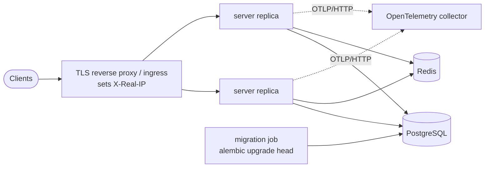

# Deploying WynnSourceServer

Two starting points:

- **[Single instance with Docker Compose](#single-instance-with-docker-compose)**: one host, everything in this folder.
- **[Larger deployments](#larger-deployments)**: what to keep in mind when running several replicas, for example on Kubernetes.

All configuration is environment variables, documented in the [root README](../README.md#environment-variables).

## Single instance with Docker Compose

`docker-compose.yaml` runs four services from the published image `ghcr.io/wynnsource/wynnsource-server`:

| Service | Role |
|---|---|
| `server` | The API, on port 8000 inside the container |
| `migration` | Runs `alembic upgrade head` once, then exits; `server` starts only after it succeeds |
| `db` | PostgreSQL 18, data in the `db-data` volume |
| `redis` | Redis (cache, rate limits, scheduler job locks), data in the `redis-data` volume |

### Start

```bash
cd deploy
cp .env.example .env
# Set at least POSTGRES_PASSWORD and WCS_ADMIN_TOKEN, and pin WCS_VERSION to a release.
docker compose up -d
docker compose ps          # server should become healthy
curl http://127.0.0.1:8000/readyz
```

To run your own checkout instead of the published image, uncomment `build: ..` in `docker-compose.yaml` and use `docker compose up -d --build`.

### Put a reverse proxy in front

The server is published on `127.0.0.1:8000` only. Expose it through a reverse proxy on the same host that:

- terminates TLS;
- sets **`X-Real-IP`** to the client address. The server uses it for rate limiting and per-user IP records, and **rejects token-authenticated requests that arrive without it** (except from `127.0.0.1`);
- forwards `Host` and `X-Forwarded-Proto`.

Example for nginx:

```nginx
location / {
    proxy_pass http://127.0.0.1:8000;
    proxy_set_header Host $host;
    proxy_set_header X-Real-IP $remote_addr;
    proxy_set_header X-Forwarded-For $proxy_add_x_forwarded_for;
    proxy_set_header X-Forwarded-Proto $scheme;
}
```

### Upgrade

```bash
# set WCS_VERSION in .env to the new release
docker compose pull
docker compose up -d       # migration runs first, then the server is recreated
```

Releases are tagged `X.Y.Z`; `latest` follows the newest release. `dev-<sha>` and `dev-latest` are pre-release builds from the `dev` branch.

### Back up

The database is the only state worth keeping. Redis holds cache and locks that rebuild themselves.

```bash
docker compose exec -T db sh -c 'pg_dump -U "$POSTGRES_USER" -Fc "$POSTGRES_DB"' > wcs_db-$(date +%F).dump
# restore into an empty database:
docker compose exec -T db sh -c 'pg_restore -U "$POSTGRES_USER" -d "$POSTGRES_DB" --clean --if-exists' < wcs_db-YYYY-MM-DD.dump
```

Keep copies off the host, and try a restore once before you need it.

### Stop

`docker compose down` keeps the volumes; `docker compose down -v` deletes the database.

## Larger deployments

The server is stateless, so it scales horizontally. State lives in PostgreSQL; Redis is shared by all replicas.



### Rollout order

1. PostgreSQL and Redis are available.
2. Run the migration **once** per release (`uv run --no-dev alembic upgrade head` in the release image), as a one-shot job, not from every replica.
3. Roll the server replicas to the same image.

### Requirements for several replicas

- **Distinct identity per replica.** Scheduled jobs take a lock in Redis held under `K8S_POD_NAME` (defaults to the hostname). Telemetry needs a distinct `service.instance.id` per replica, e.g. `OTEL_RESOURCE_ATTRIBUTES=service.instance.id=<pod or host name>`, so replicas never share a metric series.
- **Probes.** Liveness on `GET /healthz`, readiness on `GET /readyz` (port 8000). Give startup up to a minute before liveness checks begin.
- **Client IP.** The proxy or ingress in front must set `X-Real-IP` (see above). Uvicorn trusts forwarded headers only from `127.0.0.1`, `::1` and `10.0.0.0/8`.
- **Shutdown.** The container runs uvicorn as PID 1 and handles `SIGTERM` (finishes requests, flushes telemetry); give it a termination grace period of a few seconds.
- **Resources.** About 100m CPU / 256 MiB per replica at rest is a reasonable request; limit memory at around 1 GiB.

### Configuration and secrets

- Keep `WCS_ADMIN_TOKEN`, database credentials and `WCS_SENTRY_DSN` in a secret store and inject them as environment variables. Never commit them.
- Non-secret settings (`LEVEL`, `LOG_JSON`, `MAX_IP_RECORDS`, `BETA_ALLOWED_VERSIONS`) can live in plain configuration. Restart or roll the replicas when they change.

### Database

- Use a managed PostgreSQL or a PostgreSQL operator rather than a hand-run container.
- Enable point-in-time recovery (continuous WAL archiving plus base backups), store backups off the cluster, and test restores.
- Size `max_connections` for all replicas plus the migration job.

### Observability

- `LOG_JSON=true` writes one JSON object per line, with `trace_id`/`span_id`, for log pipelines.
- `OTEL_EXPORTER_OTLP_ENDPOINT` enables OpenTelemetry traces and metrics over OTLP/HTTP.
- `WCS_SENTRY_DSN` enables error reporting; `WCS_SENTRY_PROFILE_SESSION_SAMPLE_RATE` adds continuous profiling.

### Image updates

Pin a release tag and update it deliberately, or let an image-update tool follow the `X.Y.Z` tags (production) or `dev-<sha>` tags (staging). Avoid deploying `latest`, since a restart could then change the version.

### Kubernetes objects

A typical Kubernetes setup uses these objects. Write them in whatever tooling you use (plain manifests, Kustomize, Helm):

| Object | Purpose |
|---|---|
| `Deployment` | Server replicas with the probes and env above |
| `Service` | ClusterIP on port 8000 |
| `ConfigMap` / `Secret` | Settings and credentials, consumed with `envFrom` |
| `Job` | Migration, run before each rollout (e.g. as a sync or pre-upgrade hook) |
| PostgreSQL | Managed database or an operator-managed cluster |
| Redis | A small instance; persistence is optional |
| `Ingress` (or equivalent) | TLS and the `X-Real-IP` header |
